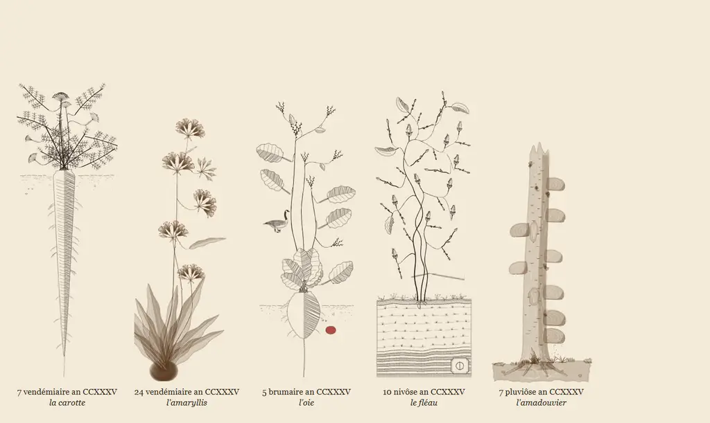
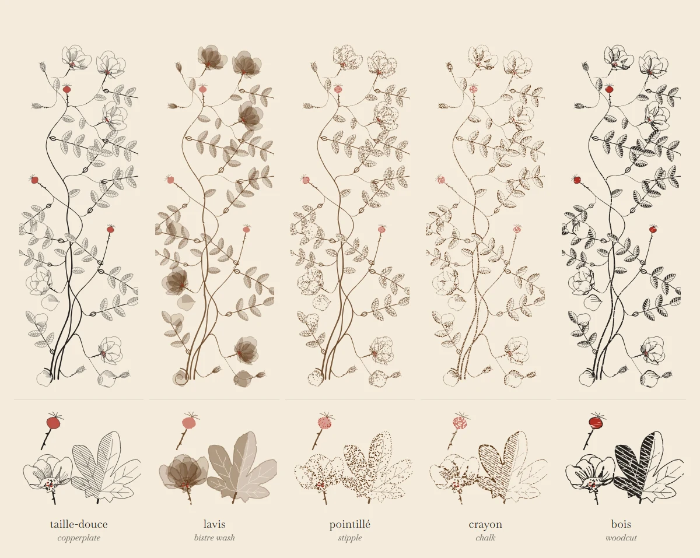

# Églantine

Églantine (`eglantine-marginalia`) grows a plant procedurally in the margin of a page and renders it as SVG in the manner of eighteenth-century French printmaking: copperplate (`taille-douce`), bistre wash (`lavis`), stipple (`pointille`), chalk (`crayon`) or relief woodcut (`bois`), or, for a change of century, in squares of light on a screen. Stems lengthen, buds open, and towards evening flowers shed their petals and go to seed (`t`); foliage fills in with whatever the page measures—words written, pages read, tasks done (`fullness`).



Gardens grow from thirteen botanical forms, each tuned by variant parameters to specific plants, or from custom forms built with the toolkit. A separate `./calendar` entry maps every day of the [French Republican calendar](https://en.wikipedia.org/wiki/French_Republican_calendar#Gallery) to its plant, adds period-engraving guests on animal and tool days, and applies the six complementary-day festivals at the year's end.

The core is strict TypeScript with zero runtime dependencies and no DOM access, so gardens grow and render identically in a browser, a web worker or Node.

## Playground

The live playground is at [cadaeic.space/eglantine](https://cadaeic.space/eglantine/), or locally via `npm run gallery` (`http://localhost:5210`). It grows today's Republican calendar plant in its own margin, re-laying out as the window resizes and switching cleanly between margin, round-the-text, hanging, headpiece (`bandeau`) and tailpiece (`cul-de-lampe`) modes.

Forms load on demand via the light entry—a visit fetches only the engine, the calendar and the single form on screen, plus a guest PNG on animal or tool days. The page takes the active palette's paper and inks, uses 44 px minimum touch targets on mobile, and skips the opening growth animation under `prefers-reduced-motion`. Controls let you switch date or pick from nineteen familiar plants, scrub time and fullness, change palette, manner, light/dark reading, margin side, visitor stance or seed, and:

- **view a proof** — open a framed plate with French/English titling and a high-scale detail zoom;
- **save as SVG** — export a standalone file with inks inlined and any guest engraving embedded and credited;
- **copy a link** — encode the current garden settings in the URL fragment;
- **use it on a website** — generate ready-to-paste code for the exact garden on screen.

Typing `usagi` or `hanami` anywhere outside an input brings *le lapin* to watch the cherry blossom fall, and a copied link keeps him there.

## Usage

```sh
npm install github:cadaeix/eglantine-marginalia
```

```ts
import { growGarden, renderGarden } from "eglantine-marginalia";

const garden = growGarden({ seed: 1793, form: "capitule", variant: { rays: 21 } });
const svg = renderGarden(garden, { t: 0.6, fullness: 0.4 }, { manner: "taille-douce", id: "margin", scale: 36 });
```

`growGarden` lays out the entire garden once from its seed; `renderGarden` draws it at a moment and returns an SVG string. Changing `t`, `fullness`, palette or manner never requires regrowing.

By default a garden fills a 6 × 22 cm column (`width` and `height` override this in centimetres; columns shorter than 22 cm proportionally shrink any root study, rock section or soil bed so stems keep their headroom). `scale` sets pixels per centimetre, and `id` prefixes internal SVG ids so multiple gardens can coexist on a page (non-alphanumeric characters are safely encoded).

A moment has two values in `[0, 1]`:

- `t` — time of day: lengthens stems, opens buds, and turns blooms to seed towards evening.
- `fullness` — how full the day is: brings in leaves, fungal mycelium and rock crystals. At `0`, a garden still shows 30% of its leaves and all of its blooms.

Both parameters are strictly monotonic: nothing shown at an earlier `t` or lower `fullness` ever disappears later.

Towards evening, shedding blooms drop petals as they go to seed—some suspended in the air below the flower, the rest resting on the ground (or gathered around the root of a `cul-de-lampe`). Petals stay where they appear and draw from their own random streams so they never shift the rest of the layout. Cupped flowers of `rosacee-coupe`, cherry in blossom (`arbre-fruitier`), free-tepal lilies and tulips (`lis-bulbe`), and clock-headed composites (`capitule`) all shed via `MotifRow.petal`.

## Round the text

```ts
const garden = growGarden({ seed: 1793, form: "rosacee-coupe", page: { side: "right", text: 14, below: 9 } });
const svg = renderGarden(garden, { t: 0.7, fullness: 0.6 }, { manner: "lavis", id: "page", scale: 36 });
```

Pass `page` to let a garden reach around a block of text, as in *florilegium*: `side` places the column left or right of the text, `text` is the text measure, and `below` is the clear height beneath the last line, all in centimetres. With at least 2 cm below the text, unfooted plants send a runner along the page's foot; with roughly 4 cm or more above any foot, flowering arcs leave the main stems to fill the space below the text. Right-hand pages mirror left-hand ones.

The returned SVG spans column and text together (with the column rect at `garden.column`) so it can sit behind the text. Leaves on the column edge may overhang by up to 1 cm, so allow a 1 cm gutter.

## Hanging

```ts
const garden = growGarden({ seed: 1793, form: "grimpante", variant: { woody: true } });
const svg = renderGarden(garden, { t: 0.7, fullness: 0.6 }, { manner: "taille-douce", id: "header", scale: 36, hanging: true });
```

`hanging: true` turns a column garden upside down to hang beneath a page header, cropping the root and any foot above the top edge so no CSS transform or clipping is needed. Hanging gardens omit fallen petals and guests (grow without a guest so foliage fills that space instead). Page gardens and ornaments cannot hang.

## Headpieces and tailpieces

```ts
const garden = growGarden({ seed: 1793, form: "rosacee-coupe", ornament: "cul-de-lampe" });
const svg = renderGarden(garden, { t: 0.7, fullness: 0.6 }, { manner: "bois", id: "tailpiece", scale: 24 });
```

With `ornament`, a garden grows in a wide horizontal band as an eighteenth-century printer's ornament instead of a margin column:

- `bandeau` (default 18 × 6 cm) — a chapter headpiece: a row of short plants spaced roughly 3 cm apart along the foot, the outer two curling their roots into scrolls.
- `cul-de-lampe` (default 12 × 8 cm) — a chapter tailpiece: stems spraying outward from one centred root, keeping the lower corners clear to form the classic inverted triangle.

`ORNAMENTS` holds the default dimensions. Plants keep their natural centimetre sizes (adjust `scale` to draw smaller), and the growth loop shrinks or omits motifs that would exceed the band's top or foot (allowing about 3 mm of overhang at the ends). Footed plants adapt to the band—deep sections lower so only their crown shows, tailpiece roots centre and shrink down to 60%, and stemless feet such as *l'amadouvier*'s birch stub scale to fit. Guests enter bands as usual, scaling down if taller than the band allows. Ornaments cannot hang or wrap around a page.

## Festivals

```ts
const garden = growGarden({ seed: 1793, form: "capitule", variant: { rays: 21 }, festival: "opinion" });
```

The Republican calendar's complementary days are named for festivals rather than plants. Passing `festival` transforms whatever plant the garden grows (on complementary days, the calendar pairs each festival with the year's last plant, *le marron*). Festival gardens omit guests and fallen petals, and work in columns, pages, headpieces and tailpieces.

| Festival | Day | Transformation |
|---|---|---|
| `vertu` | jour de la vertu | strips foliage and blooms to bare stems, hanging empty seed husks where blooms stood |
| `genie` | jour du génie | plants a cut goose quill as a stake (in the empty husk if present) and twines the stems up its shaft |
| `travail` | jour du travail | cuts the plant and binds it in a sheaf standing on its cut stalks (or a row of small sheaves in a bandeau) |
| `opinion` | jour de l'opinion | defaces blooms with red-chalk caricatures and fills empty sky—and on full pages, the text itself—with cursive scrawl |
| `recompenses` | jour des récompenses | braids the plant with oak into a civic crown tied with ribbon (adding corner-hung festoons in a bandeau) |
| `revolution` | jour de la révolution | leaves a single seed centred in the blank, sprouting a root towards evening |

Forms can supply custom `husk` and `kernel` drawings (`PlantForm` in `src/form.ts`) for `vertu`, `genie` and `revolution`: husked nuts and cotton bolls in `arbre-fruitier`, acorns, beechnuts, conkers and hazelnuts in `feuillage`, woody cones and seeds in `conifere`, and empty receptacles and achenes in `capitule`. Other forms fall back cleanly to bare stems, an earth mound, and their seed-stage bloom.

## Light entry (code splitting)

```ts
import { growGarden, loadForm, loadManner, renderGarden } from "eglantine-marginalia/lite";

const form = await loadForm("ombelle-corymbe");
const garden = growGarden({ seed: 1793, form, variant: { leaf: "pinnate" } });
const svg = renderGarden(garden, { t: 0.6, fullness: 0 }, { manner: "taille-douce", id: "margin", scale: 36 });
const neon = renderGarden(garden, { t: 0.6, fullness: 0 }, { manner: await loadManner("nekyia"), id: "screen", scale: 36 });
```

Plant forms make up most of the package weight. `eglantine-marginalia/lite` omits the registry so bundlers split each form and festival into its own chunk: `loadForm` and `loadFestival` fetch one at a time, and `growGarden` accepts the loaded modules directly. A page loads ~9 KB gzipped for the engine plus the shared kit and one form (0.2–21 KB gzipped) instead of ~117 KB for all thirteen. Festivals add 0.2–4 KB each. The period manners come with the engine; the three screen manners share a chunk of their own (about 3.4 KB gzipped), which `loadManner` fetches the first time a page draws in one, so `renderGarden` on the light entry takes a screen manner only once it is loaded.

## Forms

Each form defines stems, foliage, blooms and seed stages; variants tune it to individual species, and `resolveVariant` rejects unknown keys or out-of-range values.

| Form | Name | Draws | Calendar days |
|---|---|---|---|
| `arbre-fruitier` | arbre fruitier | trees, shrubs and fruiting shoots, from bud to ripe or splitting fruit, or shedding cherry blossom | 39 |
| `capitule` | capitule | composite flower heads going to plumed seed clocks or dry heads | 17 |
| `conifere` | conifère | needled or scaled sprays with woody cones, berry-like cones or arils | 8 |
| `cryptogame` | cryptogame | fungi over mycelium, mosses, lichens, ferns and horsetails | 10 |
| `epi-aromatique` | épi aromatique | upright stems of small flowers in spikes, whorls, heads or panicles | 45 |
| `epi-graminee` | épi de graminée | grasses and grains under their ears and panicles | 15 |
| `feuillage` | feuillage | plants known by their leaves, with catkins, nuts, samaras or berries | 36 |
| `grimpante` | grimpante | climbers held by tendrils, twining stems or rootlets | 15 |
| `hiver` | hiver | winter rocks, earths and metals in an engraved geological section with period chemical signs under bare twigs | 26 |
| `lis-bulbe` | lis et bulbe | scape-and-strap plants with six tepals over a bulb or corm | 18 |
| `ombelle-corymbe` | ombelle et corymbe | flat-topped clusters: corymbs and compound umbels | 17 |
| `racine-tubercule` | racine et tubercule | plants known by a root or tuber at the column's foot | 18 |
| `rosacee-coupe` | rosacée en coupe | radial and cupped flowers in perspective going to hips, haws and capsules | 24 |

The specimen gallery at `specimens.html#all` renders every form's examples at bloom and seed alongside enlarged motifs, calendar dates, festivals and palettes.

## Manners



`MANNERS` lists all eight styles supported by `renderGarden`: five printmaking styles, and three screen manners of the author's own.

- **`taille-douce`** — copperplate line engraving: paper-white forms, fine ink contours, hatched shadows and solid ink stems.
- **`lavis`** — bistre wash: translucent layers of wash darker in shadow and pooled at the edges, paper-lifted veins, and a soft bled edge.
- **`pointille`** — stipple engraving after the plates from Pierre-Joseph Redouté's lilies and roses (London 1787; Muséum national d'histoire naturelle from 1793): modelled in wash-coloured dots dense in shadow and rim and sparse on the lit side inside a dotted contour, with accented hips and berries tinted underneath *à la poupée*.
- **`crayon`** — the chalk manner developed by Jean-Charles François and Gilles Demarteau in the 1750s: loose wash hatching, a contour heavy in shadow and skipping on the lit side, pastel-tinted accents, and paper tooth breaking through every stroke.
- **`bois`** — relief woodcut after Jean-Michel Papillon's *taille d'épargne*: bold letterpress keyblock contours, solid ink shadows cut back in white line with the gouge and crossed by white veins on foliage and fruit, open black cuts on pale petals, solid second-block accents, and a faint pearwood grain.

### Screen manners

The screen manners are not of any period. They raise the plant as light on a dark screen, in the squares of the author's own pictures, and look their best on the `neon` palette by candlelight. Every square lies on a grid fixed to the page and takes its values from its place, so a leaf lying aslant is still set square, the same seed draws the same squares, and a growing stem keeps the squares it has shown. A soft glow lies over everything.

- **`mosaique`** — fine tesserae: translucent blocks deep in each form, finer tiles thickening into a lit rim, loose tiles and the odd streak drifting off its edge, veins cut through as dark leading, and stems stepped in pixels. Its colours run from the wash to the accent.
- **`carreaux`** — panes: each form becomes a few large, see-through panes chained along its length and turned any way, some dripping light below them, among chips of colour and lit windows; stems break into loose squares. Its colours go from the wash to the accent and back by the greens and reds, so a palette of two inks gives a whole neon city.
- **`nekyia`** — the plant called up as a digital necromancer would: leaves and the foot it stands on in fine tesserae of a neon of their own, blooms and stems in panes, so the leaves' shapes stay legible while the flowers turn to blocks of colour.

Guests appear as holograms. An animal or a tool has its engraving's hatching closed up into its silhouette, a bright rim drawn round it in the manner's colours, and its own engraved lines shown faintly inside over glowing scan lines, so a goose is still a goose and a beehive a wireframe hive. The browser takes the outline from the drawn engraving through an SVG filter, so the core still never reads the image. Within a form, the lines an engraver cut, a leaf's veins or a rock's hatching, are cut through as dark leading, and a form drawn over another hides the squares beneath it, so a rock's strata read as glass in lead, not as a heap. Thin tools, a scythe or a spade, show only as a fine outline.

`mosaique` and `carreaux` take every colour from the palette. `nekyia`'s tesserae keep their own neon whatever the palette, and only its panes follow it. The in-between colours are CSS `color-mix()`, which browsers draw and some standalone SVG editors do not. The main entry draws them by their ids; the light entry loads them first with `loadManner` (see [Light entry](#light-entry-code-splitting)), so a page that never draws one never fetches them.

### Inks

SVGs reference four CSS custom properties with built-in fallbacks: `--eglantine-ink`, `--eglantine-paper`, `--eglantine-accent` and `--eglantine-wash`. For standalone SVGs or `` tags where no stylesheet applies, `withInks(svg, inks)` bakes colours directly into the markup (keeping defaults for omitted inks).

When writing custom themes: match `--eglantine-paper` to the surface behind the garden (forms are cut out of paper), keep `--eglantine-wash` dark enough to hold up at 14–38% opacity in `lavis` (default bistre sits at 8.4:1 contrast), and separate `--eglantine-accent` clearly from the wash.

## Palettes

```ts
import "eglantine-marginalia/palettes.css";
// <aside data-eglantine-palette="madder">…</aside> tints every garden inside it.

import { paletteInks, withInks } from "eglantine-marginalia";
const print = withInks(svg, paletteInks("iron-gall", "dark"));
```

Eight palettes inspired by eighteenth-century France, and one of today's, ship with both light (daylight) and dark (candlelight) readings. In CSS, `data-eglantine-palette="madder"` follows `prefers-color-scheme`, while `madder-light` or `madder-dark` pins a reading. Every wash holds 6:1–10:1 contrast against its paper and every ink at least 7:1.

| Palette | Name | Period | Wash and accent |
|---|---|---|---|
| `puce` | Couleur de puce | 1775 | flea's-back brown, with the rose of *cuisse de nymphe émue* |
| `olive` | Boue de Paris | 1775 to 1781 | toad green, with Dutch-cheese orange |
| `cockade` | Palais-Royal | 12 July 1789 | cockade green, with the red of Paris |
| `iron-gall` | Le Vieux Cordelier | winter 1793 to 1794 | aged iron-gall ink, with sealing-wax red |
| `pansy` | Germinal an II | spring 1794 | pansy violet, with jonquil yellow |
| `porcelain` | Fonds de Sèvres | 1752 to 1763 | Sèvres blue, with gilding |
| `madder` | Toile de Jouy | 1770 to the 1790s | madder, with pencilled indigo |
| `red-chalk` | Aux trois crayons | about 1715 to 1720 | bistre on chamois, with red chalk |
| `neon` | Nécromancie numérique | an CCXXXV | magenta light on the dark of a screen, with cyan; made for the screen manners |

Brown, madder and blue washes suit every day; the green washes (`olive`, `cockade`) also tint geological sections and dead wood green.

## The calendar

```ts
import { calendarDay, figureURL } from "eglantine-marginalia/calendar";
import { growGarden, renderGarden } from "eglantine-marginalia";

const day = calendarDay("2026-10-30");
// day.dateline: "8 brumaire an CCXXXV"; day.name: "la scorsonère"
const garden = growGarden({
  seed: 1793, form: day.plant.form, variant: day.plant.variant,
  ...(day.guest ? { guest: day.guest } : {}), ...(day.festival ? { festival: day.festival } : {}),
});
const svg = renderGarden(garden, { t: 0.5, fullness: 0.5 }, {
  manner: "lavis", id: "today", scale: 36, ...(day.guest ? { guestFigure: figureURL(day.guest.figure).href } : {}),
});
```

On animal days, visitors stand where their figure asks—most on a coiled shoot grown out of a main stem, the bee, fish and silkworm among the stems, and the otter on the ground. Pass `{ ...day.guest, stance: "stems" }` to let any visitor float among the stems instead.

`figureGuest` pairs any of the 72 engravings with any plant (`growGarden({ seed, form: "rosacee-coupe", guest: figureGuest("chat") })` with `figureURL("chat")`). `HANAMI` is a bonus non-calendar entry pairing *le lapin* with the flowering cherry:

```ts
import { figureURL, HANAMI } from "eglantine-marginalia/calendar";

const garden = growGarden({ seed: 1793, form: HANAMI.plant.form, variant: HANAMI.plant.variant, guest: HANAMI.guest });
const svg = renderGarden(garden, { t: 0.95, fullness: 0.8 }, { manner: "lavis", id: "hanami", scale: 36, guestFigure: figureURL(HANAMI.guest.figure).href });
```

## Extending

`growGarden` accepts any `FormModule` object in place of a registered id. `eglantine-marginalia/toolkit` exports the geometry, seeded RNG, body builders and shared foliage used by the bundled forms. Forms can stand on a custom `Foot` (roots, strata, stumps) and ink stems via `StemInk` (see `src/form.ts`).

`renderGarden` also accepts a `decorate(garden, sheet)` callback returning raw SVG `under`, `over`, or numbered `inlays` (which sit among the plant's layers inside any manner filter). Decoration strings are injected verbatim and must come from trusted callers.

Forms are authored in centimetres for the 6 × 22 cm column; pages and ornaments scale motif counts proportionally to their area while keeping botanical parts at their natural size. Use `scale` to draw the same garden larger or smaller.

## Development

```sh
npm install
npm test                 # garden invariants, form examples, calendar and festivals
npm run typecheck
npm run gallery          # playground at http://localhost:5210
npm run build            # library in dist/
npm run gallery:build    # static website in site-dist/
npm run gallery:preview  # serve built site on http://localhost:5210
npm run check            # typecheck, tests, library build and site build
npm run sweep            # stress-test every plant across sizes, layouts and festivals
```

Stop the dev server before running `gallery:preview` on the same port. `site-dist/` uses relative asset URLs (`base: "./"`), so it deploys cleanly at a site root or subdirectory such as [cadaeic.space/eglantine](https://cadaeic.space/eglantine/).

## History

The French Republican calendar (1793–1805) divided the year into twelve 30-day months plus five complementary days (six in a sextile year). In his 1793 report to the National Convention, Fabre d'Églantine named every regular day for a plant, every fifth day for an animal, and every tenth for a tool. This library preserves his printed French names and assigns all 288 plant days a form and variant (`PLANTS`); animal and tool days grow the previous day's plant with an engraved period visitor or resting tool.

Fabre named the complementary days for festivals—Genius, Labour, Actions, Rewards, Opinion ("on corrompt les tribunaux, on ne corrompt pas l'opinion") and, in sextile years, national games. The library follows the Convention's revised order (Virtue, Genius, Labour, Opinion, Rewards) and the later name Revolution for the sixth day, growing *le marron* under each festival.

Per the decree of 4 frimaire an II, each year opens at midnight on the day of the true autumn equinox at the Paris Observatory. `republicanDate` computes the September equinox via Meeus's *Astronomical Algorithms* and the Observatory's true solar clock, matching the historical sextile years III, VII and XI and tracking the seasons through the year 3000 (later dates throw a `RangeError`).

All 72 guest figures are ink masks cut from public-domain period engravings scanned by the Smithsonian Libraries, Bibliothèque interuniversitaire de santé (Paris), University of Seville, Naturalis, Getty Research Institute, Rijksmuseum and other institutions. See [figures/PROVENANCE.md](figures/PROVENANCE.md) for every plate and scan licence.

## Credits

- Growth loop adapted from Kevin Raymond's [florilegium](https://github.com/kevinraymond/florilegium) (MIT; notice in [florilegium-LICENSE.txt](florilegium-LICENSE.txt)), following Wong, Zongker & Salesin, "Computer-Generated Floral Ornament" (SIGGRAPH 1998).
- Palette lightness method inspired by [madoromi](https://github.com/the-moonwitch/madoromi) (no shared code or colours); historical colour names draw partly on *Les couleurs au 18e siècle* (Musée Les Bateliers, Namur, 2023).
- English calendar day names come from Wikipedia's French Republican calendar tables.
- Plant-only SVGs require no scan attribution. Six guest figures derive from scans by the Bibliothèque interuniversitaire de santé, Paris under the Etalab Open Licence, which requires attribution when those images are reused or redistributed (including with the full package).

## Licence

Code is under the [MIT licence](LICENSE). Guest figures derive from public-domain engravings; see [figures/PROVENANCE.md](figures/PROVENANCE.md) for scan terms and credits.
