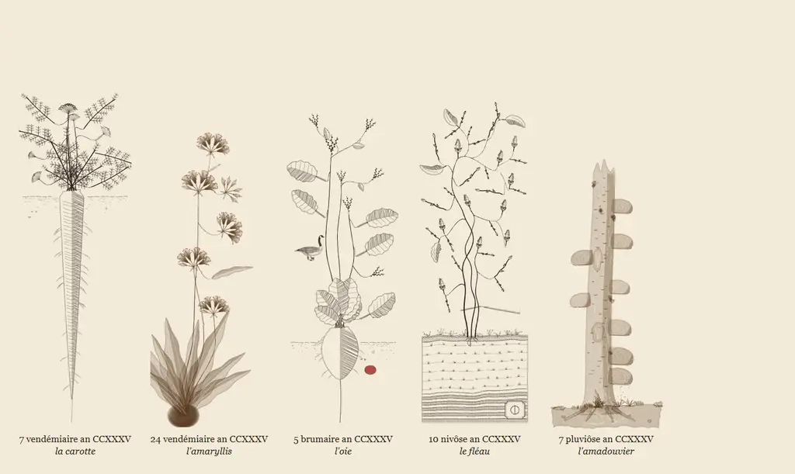

# Églantine

Églantine (`eglantine-marginalia`) grows a plant in the margin of a page and draws it in the manner of eighteenth-century French engraving, in copperplate line or in bistre wash. The plant keeps time with the day. Its stems lengthen and its buds open, and towards evening its flowers go to seed. Its leaves come in as the day fills, with words written, pages read or whatever else the page counts.



A garden grows from one of thirteen plant forms, each tuned by a variant to a particular plant: carrots, pears, tulips and so on. A page can choose its own plants from these and never touch the calendar, or build new forms with the toolkit.

The calendar, a separate entry point, can choose instead: a plant for each day of the year, after the [French Republican calendar](https://en.wikipedia.org/wiki/French_Republican_calendar#Gallery). On animal and tool days, the plant has company, cut from engravings of the period. The complementary days at the year's end are named for festivals, and on each of them the day's festival does something to the year's last plant.

The library is TypeScript with no runtime dependencies. It grows each garden procedurally from a seed and a plant form, then draws it as an SVG string at any moment of the day. Growing and rendering use no DOM, so a garden can be drawn in a browser, a web worker or Node.

## Playground

The playground is online at [cadaeic.space/eglantine](https://cadaeic.space/eglantine/), and `npm run gallery` serves it at `http://localhost:5210`. It is a page with Églantine in its own margin. It opens on the day's plant from the calendar, with the day's French name and its English one, and grows from the morning to the hour of the visit. The garden keeps to the margin, reaches round the text, or hangs from the top of the margin. It is grown for the page as the window lays it out, so a narrower or shorter window gives it another room to fill. Round the text, the page always leaves at least six centimetres under the text's last line, since the text is as long in a short window as in a tall one; a taller window leaves more. The page takes the chosen palette's paper and inks.

On phones and narrower tablets, the garden and its playback button stay in view above the settings. Touch controls have hit areas at least 44px high. With reduced motion enabled, the page skips the opening animation and offers "show the evening" instead of "watch the day".

The playground loads its plant forms one at a time, as the light entry does. A visit fetches the engine, the calendar and the one form the day's garden draws, a guest's engraving only on its own day, and the plant chooser loads the other forms when it opens.

The settings choose another day or one of eighteen familiar plants, the time and fullness of the day, the palette, the manner and the light, the side of the page, whether the animals stand on shoots or float among the stems, and the seed. "random plant" picks a day named for a plant, and "random visitor" a day whose animal visits the garden or whose tool lies at its foot. Three settings keep the result:

- "save as SVG" writes the garden with its inks, and embeds and credits any engraving.
- "copy a link" keeps the settings in the URL's fragment.
- "use it on a website" shows the code that grows the same garden.

The English day names come from the tables in Wikipedia's article on the French Republican calendar.

## Usage

```sh
npm install github:cadaeix/eglantine-marginalia
```

```ts
import { growGarden, renderGarden } from "eglantine-marginalia";

const garden = growGarden({ seed: 1793, form: "capitule", variant: { rays: 21 } });
const svg = renderGarden(garden, { t: 0.6, fullness: 0.4 }, { manner: "taille-douce", id: "margin", scale: 36 });
```

`growGarden` lays the whole garden out once from its seed. `renderGarden` draws it at a moment and returns an SVG string. The garden fills a column 6 cm wide and 22 cm tall unless `width` and `height` say otherwise. With `ornament`, it grows instead as a headpiece or a tailpiece (see [Headpieces and tailpieces](#headpieces-and-tailpieces)). `scale` sets the pixels per centimetre. `id` prefixes the SVG's internal ids, so several gardens can share a page. The renderer encodes characters other than ASCII letters, digits and hyphens in internal SVG ids.

A moment has two values between 0 and 1:

- `t` is the time of day. It brings the stems, then the buds, which open and, near the end of the day, go to seed.
- `fullness` measures how full the day is, in whatever sense the page chooses: words written, pages read, tasks done. It brings the leaves, the mycelium of the fungi and the crystals in the rock. A garden at fullness 0 already shows 30% of its leaves, and a quiet day keeps the same flowers as a full one.

Neither value takes back what it has shown: a leaf or bloom present at some moment stays present at every later time and greater fullness.

## Round the text

```ts
const garden = growGarden({ seed: 1793, form: "rosacee-coupe", page: { side: "right", text: 14, below: 9 } });
const svg = renderGarden(garden, { t: 0.7, fullness: 0.6 }, { manner: "lavis", id: "page", scale: 36 });
```

Given the text beside its column, a garden reaches round it, as florilegium's does. `side` says which side of the text the column stands on, `text` how wide the text is, and `below` how much free room lies under the text's last line, down to the page's foot, all in centimetres. With two centimetres or more below the text, a runner leaves the root along the foot of the page. With about four centimetres or more, arcs leave the main stems for the room under the text, each ending in a bloom, and the garden fills whatever room it reaches. A right-hand page is drawn as the mirror image of a left-hand one.

The SVG covers the column and the text together, with the column at `garden.column`, so it lies under the text on the page. The garden keeps below the text's last line, but leaves on the column's edge overhang it by up to a centimetre, so leave a centimetre of gutter between the column and the text.

A plant with a foot stands on its root study, rock section or bed of earth in the column and sends out no runner, since the room beside its foot lies underground. Its arcs leave the stems above the foot.

## Hanging

```ts
const garden = growGarden({ seed: 1793, form: "grimpante", variant: { woody: true } });
const svg = renderGarden(garden, { t: 0.7, fullness: 0.6 }, { manner: "taille-douce", id: "header", scale: 36, hanging: true });
```

With `hanging`, the garden hangs upside down from the top of its column, for a margin that begins under a page's header. The root, and any foot the plant stands on, is cropped away above, so the SVG is shorter than the garden by that much and needs no transform or clipping from the page. A hanging garden draws no guest, which would hang upside down with it: grow it without one, and its leaves fill the room the guest would take, with no empty shoots left where animals would have stood. A garden grown round a page cannot hang, since its runner and arcs would turn over onto the text.

## Headpieces and tailpieces

```ts
const garden = growGarden({ seed: 1793, form: "rosacee-coupe", ornament: "cul-de-lampe" });
const svg = renderGarden(garden, { t: 0.7, fullness: 0.6 }, { manner: "taille-douce", id: "tailpiece", scale: 24 });
```

With `ornament`, a garden grows in a wide, short band as one of the ornaments that eighteenth-century printers set over and under a text, instead of in the margin's column. As a `bandeau`, the headpiece over a chapter, the plant grows as a bed of short plants that stand side by side along the band's foot, about 3 cm apart. The bed's outer two plants curl their roots into scrolls. As a `cul-de-lampe`, the tailpiece at a chapter's end, the plant sprays out to both sides from one root in the middle of the band's foot. The band's lower corners stay empty, so the spray narrows to its root as the tailpiece's inverted triangle does.

A bandeau grows in 18 × 6 cm and a cul-de-lampe in 12 × 8 cm unless `width` and `height` say otherwise, and `ORNAMENTS` holds these sizes. The plants keep the sizes they have in the column, so a smaller drawing of a band comes from a smaller `scale`. A narrower band holds fewer plants. The growth loop keeps a band's drawing inside its top and its foot: it shrinks or leaves out any leaf or bloom whose drawing would run out. Leaves reach no more than about 3 mm past a band's ends.

A plant with a foot stands on it in a band as well. A bed's foot runs the band's width, with one plant of the bed on the foot's crown, and a deep foot such as a rock section is lowered until only its top shows above the band's lower edge. A cul-de-lampe's foot is a column's width, centred under its root and shrunk to as little as 60%, so that a carrot's root or a turnip's swelling shows as the tailpiece's point. A longer root runs on past the band's lower edge. A foot that is the whole plant, such as the dead birch of l'amadouvier, is shrunk until it fits.

The day's guest comes into a band as it does into the column: an animal stands on a shoot of its own where the band leaves room for one, and a tool lies among the plants. A figure taller than the band allows, such as the incubator of le couvoir, is drawn smaller. A band cannot hang, since it stands on its foot. Nor can it reach round a page, since it lies over or under the text rather than beside it.

## Festivals

```ts
const garden = growGarden({ seed: 1793, form: "capitule", variant: { rays: 21 }, festival: "opinion" });
```

The French Republican calendar names its complementary days for festivals rather than plants. With `festival`, a garden keeps one of them, and since a festival names no plant, it does something to the plant the garden grows: it strips it, stakes it, binds it, mocks it, crowns it or leaves one seed of it. The calendar gives each complementary day its festival and the year's last plant, le marron. A festival garden has no guest, and a page round it works as it does for any garden.

| Festival | Day | What it does to the plant |
|---|---|---|
| `vertu` | jour de la vertu | leaves the stem alone, without flower or leaf; where a bloom was, the husk its seed has left hangs empty |
| `genie` | jour du génie | plants a quill at its foot as a stake, in its empty husk if it has one, and twines the stems up the quill |
| `travail` | jour du travail | cuts it and binds it in a sheaf, standing on its cut stalks |
| `opinion` | jour de l'opinion | defaces it in the accent ink, with caricatures and moustaches on its blooms and scrawl in the sky above, and on a page under the text and over it |
| `recompenses` | jour des récompenses | braids it with oak into a civic crown, tied with a ribbon |
| `revolution` | jour de la révolution | leaves a single seed in the middle of the column, whose root comes out towards evening |

Time and fullness bring a festival garden as they bring any other, and still never take back what they have shown. Virtue, which has no foliage, does not answer to fullness, and Opinion's marks come in with it: the more the page writes, the more the margin writes back. A form can draw two things for the festivals, `husk` and `kernel` (see `PlantForm` in `src/form.ts`); le marron's form draws its empty burr and its chestnut. A plant without them keeps its stems bare under Virtue, stakes its quill in a mound of earth under Genius, and leaves its bloom gone to seed under the Revolution.

A festival keeps its idea in a headpiece or a tailpiece. Virtue and the Revolution grow in a band as they do in the column. Genius stakes a single quill in the middle of a bed, where the middle plant climbs it and the others lean towards it. In a cul-de-lampe the quill stands at the root, and every stem of the spray winds up its shaft before it arches out. Labour binds each plant of a bed in a small sheaf of its own, and a cul-de-lampe in a single sheaf that tapers to its cut ends. Opinion writes a line of scrawl along a band's thin sky and more lines where the band is emptiest, a cul-de-lampe's lower corners among them. Rewards keeps its crown in a cul-de-lampe, with the ribbon's ends hanging to the tailpiece's point. In a bandeau it hangs a festoon of oak and leaves from each side of the crown, caught up by bows at the band's top corners.

## In a browser, lightly

```ts
import { growGarden, loadForm, renderGarden } from "eglantine-marginalia/lite";

const form = await loadForm("ombelle-corymbe");
const garden = growGarden({ seed: 1793, form, variant: { leaf: "pinnate" } });
const svg = renderGarden(garden, { t: 0.6, fullness: 0 }, { manner: "taille-douce", id: "margin", scale: 36 });
```

The plant forms are most of the library's weight. The `eglantine-marginalia/lite` entry is the main entry without them or the festivals: `loadForm` loads one form on its own and `loadFestival` one festival, and `growGarden` grows from the form and festival it is given rather than from their ids. A bundler splits each form and festival into its own chunk, so a page fetches about 9 KB of engine, the shared drawing kit and the one form it draws, from 0.2 to 21 KB gzipped, instead of 117 KB for every form. A festival adds 0.2 to 4 KB.

## Forms

A form describes what a plant is made of and how it stands: its stems, leaves, bloom and what the bloom becomes. A variant tunes a form to a particular plant, such as a pear rather than a fig. Each form documents its variant keys, and `resolveVariant` rejects unknown keys and values out of range.

| Form | Name | Draws | Calendar days |
|---|---|---|---|
| `arbre-fruitier` | arbre fruitier | trees, shrubs and fruiting shoots, shown by fruit that buds, swells and ripens | 39 |
| `capitule` | capitule | composite flower heads, going to a clock of plumed seeds or a dry head | 17 |
| `conifere` | conifère | needled or scaled sprays and their cones, berry-like cones or arils | 8 |
| `cryptogame` | cryptogame | fungi from soil and dead wood over their mycelium, mosses, lichens, ferns and horsetails | 10 |
| `epi-aromatique` | épi aromatique | upright stems of small flowers in spikes, whorls, heads or panicles | 45 |
| `epi-graminee` | épi de graminée | grasses and grains under their ears and panicles | 15 |
| `feuillage` | feuillage | plants shown by their leaves, with catkins, nuts or berries | 36 |
| `grimpante` | grimpante | climbers held by tendrils, twining stems or rootlets | 15 |
| `hiver` | hiver | winter: rocks, earths and metals in an engraved geological section with their period chemical signs, under bare twigs | 26 |
| `lis-bulbe` | lis et bulbe | scape-and-strap plants with six tepals over a bulb or corm | 18 |
| `ombelle-corymbe` | ombelle et corymbe | flat-topped clusters: corymbs and compound umbels | 17 |
| `racine-tubercule` | racine et tubercule | plants known by a root or tuber at the foot of the column, some of them very long | 18 |
| `rosacee-coupe` | rosacée en coupe | radial and cupped flowers in perspective, going to hips, haws and capsules | 24 |

The forms carry French names, like the calendar's days, and plain lowercase ASCII ids.

The playground's Specimens link opens the technical gallery at `specimens.html#all`. It shows every form's examples at bloom and at seed, with their flowers and leaves drawn large, the calendar's garden for any date, and every palette.

On narrow screens, figures scale to fit and variant tables scroll horizontally.

## Manners

`taille-douce` is the copperplate: paper-white forms with a fine outline, shade cut as hatching and stems in solid ink. `lavis` is the wash: transparent layers of bistre, darker in the shade and pooled at the edges, with veins lifted out in paper.

The SVG refers to four inks through CSS custom properties, each with a fallback colour: `--eglantine-ink`, `--eglantine-paper`, `--eglantine-accent` and `--eglantine-wash`. A page's stylesheet can set them to match a theme. A garden shown as an image or saved as a file has no stylesheet, so `withInks(svg, { ink: "#1b1b1b" })` writes the colours into the SVG and keeps the fallbacks for the inks left out.

A theme sets the four inks with a few needs in mind. The forms are cut out of `--eglantine-paper`, so the paper has to match the surface the garden lies on: in a sidebar of another colour, set the paper to that colour, or the forms show as patches of the page. The lavis manner lays the wash in layers of 14% to 38% opacity, and the default bistre stands 8.4:1 in contrast from the default cream; a much lighter wash fades out. The accent marks pistils that sit on washed petals, so it should stand apart from the wash.

## Palettes

```ts
import "eglantine-marginalia/palettes.css";
// <aside data-eglantine-palette="madder">…</aside> tints every garden inside it.

import { paletteInks, withInks } from "eglantine-marginalia";
const print = withInks(svg, paletteInks("iron-gall", "dark"));
```

Eight palettes come with the library, after colours inspired by eighteenth-century France. Each has a light reading, by daylight on a pale page, and a dark one, by candlelight on a dark page. In the stylesheet, `data-eglantine-palette="madder"` follows the system's colour scheme, and `madder-light` or `madder-dark` fixes a reading. Every wash stands between 6:1 and 10:1 from its paper and every line at least 7:1.

| Palette | Name | Period | Wash and accent |
|---|---|---|---|
| `puce` | Couleur de puce | 1775 | flea's-back brown, with the rose of cuisse de nymphe émue |
| `olive` | Boue de Paris | 1775 to 1781 | toad green, with Dutch-cheese orange |
| `cockade` | Palais-Royal | 12 July 1789 | cockade green, with the red of Paris |
| `iron-gall` | Le Vieux Cordelier | winter 1793 to 1794 | aged iron-gall ink, with sealing-wax red |
| `pansy` | Germinal an II | spring 1794 | pansy violet, with jonquil yellow |
| `porcelain` | Fonds de Sèvres | 1752 to 1763 | Sèvres blue, with gilding |
| `madder` | Toile de Jouy | 1770 to the 1790s | madder, with pencilled indigo |
| `red-chalk` | Aux trois crayons | about 1715 to 1720 | bistre on chamois, with red chalk |

A wash in one brown, madder or blue suits every day. The green washes of `olive` and `cockade` suit flowers but turn rock sections and dead wood green as well.

## The calendar

```ts
import { calendarDay, figureURL } from "eglantine-marginalia/calendar";
import { growGarden, renderGarden } from "eglantine-marginalia";

const day = calendarDay("2026-10-31");
// day.dateline: "8 brumaire an CCXXXV"; day.name: "la scorsonère"
const garden = growGarden({
  seed: 1793, form: day.plant.form, variant: day.plant.variant,
  ...(day.guest ? { guest: day.guest } : {}), ...(day.festival ? { festival: day.festival } : {}),
});
const svg = renderGarden(garden, { t: 0.5, fullness: 0.5 }, {
  manner: "lavis", id: "today", scale: 36, ...(day.guest ? { guestFigure: figureURL(day.guest.figure).href } : {}),
});
```

On a complementary day, `day.plant` is the year's last plant and `day.festival` names the day's festival; [History](#history) explains the days, their guests and their festivals. An animal stands where its figure asks, most of them on a shoot of their own. To let it float among the stems instead, as every animal once did, grow the garden with `{ ...day.guest, stance: "stems" }` as its guest.

## Extending

`growGarden` also accepts a `FormModule` object in place of a registered id. The `eglantine-marginalia/toolkit` entry point exports what the bundled forms are built with: plane geometry, seeded randomness, engraved bodies and the shared leaves and flowers. A form can grow out of a foot, such as a root, a stump or a bed of strata drawn at the column's base, and can ink its stems as threads or bark (see `Foot` and `StemInk` in `src/form.ts`).

`renderGarden` takes a `decorate` option that lays further marks on a garden. An inlay lies at a numbered layer among the plant's parts, inside the wash, and the `under` and `over` marks lie beneath and above the whole garden. Decoration strings are raw SVG and must come from trusted sources.

The forms are drawn for the 6 × 22 cm column. Their sizes are in centimetres and a foot is placed within that column, so a much narrower or shorter column crowds the plants and a much larger one spreads them out. A garden on a page or in a band holds more of each motif in proportion to its room, at the same sizes, so it fills the room rather than thinning out. A larger drawing of the same garden comes from a larger `scale`.

## Development

```sh
npm install
npm test                 # garden invariants, form examples, and calendar
npm run typecheck
npm run gallery          # playground at http://localhost:5210
npm run build            # library in dist/
npm run gallery:build    # static website in site-dist/
npm run gallery:preview  # serve the built website at http://localhost:5210
```

`npm run check` runs typechecking, tests, and both builds. Stop the development server before running the preview server on the same port.

### Static hosting

Upload the contents of `site-dist/` to a static host after `npm run gallery:build`. Relative asset URLs support a site root or a subdirectory on a personal website. The build includes the playground, the specimen gallery, fonts and their licence, and guest figures.

The playground at [cadaeic.space/eglantine](https://cadaeic.space/eglantine/) is such a build, copied into that site.

## History

The French Republican calendar was in use from 1793 to 1805. It divides the year into twelve months of thirty days, followed by five complementary days, or six in a sextile year. In his report to the National Convention in 1793, Fabre d'Églantine gave each day of a month a name: a plant for most days, an animal for every fifth day and a tool for every tenth. The library takes the names as they were printed and gives each of the 288 plant days a form and a variant (see `PLANTS`). On an animal or tool day the garden grows the previous day's plant, and an engraved figure of the animal visits it or the tool lies at rest at its foot. Most animals stand on a shoot that coils out of a stem for them, as creatures stand on the scrolls of eighteenth-century ornament; the bee, the fish and the silkworm keep among the stems, and the otter stands on the ground. In a margin taller than the standard column, an animal comes more than once.

Fabre named the complementary days for festivals instead: of Genius, Labour, good Actions, Rewards and Opinion, and in a sextile year a sixth day of national games. On the festival of Opinion, [his report](https://fr.wikisource.org/wiki/Rapport_sur_le_calendrier_r%C3%A9publicain) has it, anyone could say what they liked of a public official, in songs, caricatures and pasquinades: "on corrompt les tribunaux, on ne corrompt pas l'opinion". The Convention renamed the festival of Actions for Virtue and put it first, and moved Opinion to the fourth day; the library follows that order, and names the sixth day for the Revolution, as later calendars did. Fabre and the Convention left the festivals' ceremonies to be settled, and none of the days names a plant, so on each of them the garden grows the year's last plant, le marron, which the year's last day grows too, and the festival does something to it.

The Republic declared years III, VII and XI sextile before it abolished the calendar, and later readings disagree on the years after. `republicanDate` keeps the four-year rhythm those years set: year XV and every fourth year after are sextile, with no exception for centuries. By this rule 31 October 2026 is 8 brumaire an CCXXXV, a day later than a reading that follows the autumn equinox.

The figures are ink masks cut from engravings of the period, in public-domain scans by the Smithsonian Libraries, the Bibliothèque interuniversitaire de santé in Paris, the University of Seville, Naturalis, the Getty Research Institute and other libraries, served through the Internet Archive, and by the Rijksmuseum. [figures/PROVENANCE.md](figures/PROVENANCE.md) lists the work, plate and scan for each of the 72 figures, one for every animal and tool day.

## Credits

The growth loop follows the grown composition of Kevin Raymond's [florilegium](https://github.com/kevinraymond/florilegium), a LuaLaTeX package under the MIT licence, whose notice is in [florilegium-LICENSE.txt](florilegium-LICENSE.txt). Florilegium in turn follows Michael T. Wong, Douglas E. Zongker and David H. Salesin, "Computer-Generated Floral Ornament", SIGGRAPH 1998.

The palettes were resolved after the method of [madoromi](https://github.com/the-moonwitch/madoromi), which reads historical inks at the lightness each role needs; they share no code or colours with it. Several colour names come from the children's trail [Les couleurs au 18e siècle](https://lesbateliers.namur.be/documentation-et-presse/publications/carnets-pedagogiques/les-couleurs-du-18e-siecle) (Musée Les Bateliers, Namur, 2023).

Plant-only SVGs require no attribution to the scanning libraries. Six guest figures use scans by the Bibliothèque interuniversitaire de santé, Paris under the Etalab Open Licence. The licence requires attribution to the library when those images are reused or redistributed, including within the full package.

## Licence

The code is licensed under [MIT](LICENSE). Copies or substantial portions of the code must retain its copyright and licence notices.

The guest figures derive from public-domain engravings. [Figure provenance](figures/PROVENANCE.md) records their scan terms and source credits.
